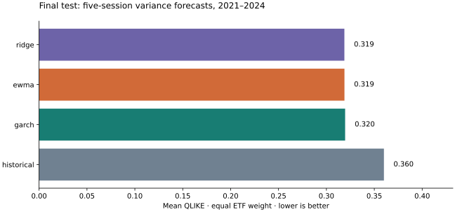

# VolatilityLab

Independent, reproducible research on a concrete question: **Do more complex models improve out-of-sample volatility forecasts over historical and exponentially weighted baselines?**

[Interactive explorer](https://gagefagan-create.github.io/volatilitylab/) · [Full research report](https://gagefagan-create.github.io/volatilitylab/report.html) · [Report source](docs/report.md)

## Findings

On SPY, QQQ and IWM in the frozen 2021–2024 test, **RIDGE** has the lowest equal-weight QLIKE: **0.3188**. This selected case study does not establish general model superiority. See the report for each ETF, MSE, paired block-bootstrap uncertainty, all 14 validation configurations, ablations and failure logs. Negative outcomes are retained.

Ridge’s aggregate QLIKE lead over EWMA is only 0.0000824, with a 20-session block-bootstrap interval of [−0.03185, 0.03147]. GARCH also shows no clear gain over EWMA. EWMA has the lowest aggregate MSE. The evidence does not establish an advantage from model complexity.



## Reproduce

Python 3.14 was used for the published run. From this directory:

```bash
python3 -m venv .venv
source .venv/bin/activate
pip install -r requirements-lock.txt
pip install --no-deps -e .
pytest -q
volatilitylab validate --out docs/reproduction
volatilitylab test --out docs/reproduction
python scripts/build_report.py --out docs/reproduction
python -m http.server 8000 --directory docs
```

Open http://localhost:8000. Test execution requires a frozen validation record with matching config/data/source hashes and refuses to overwrite a test result. Keep `data/raw` locally for exact-input reproduction; Yahoo can revise historical data. A clean re-download may not match the published hashes. Offline tests use only clearly labeled synthetic fixtures.

## Architecture

- `data.py`: adjusted-close acquisition, calendar checks and raw input hashes.
- `features.py`: backward features, five-session targets and purged partitions.
- `models.py`: historical, EWMA, analytical GARCH and standardized ridge; observable-label walk-forward fitting.
- `evaluation.py`: QLIKE, MSE and synchronized moving-block intervals.
- `reporting.py`: plots, research report and buildless interactive explorer.
- `cli.py`: separate validation, frozen selection, final test and report commands.
- `configs/study.json`: complete pre-test search grid and deterministic seed.
- `docs/results`: actual forecasts, configuration selection, provenance and fit audits.

The daily-return variance proxy is the sum of the next five squared log returns, not intraday realized volatility. Evaluation uses chronological initial training (2010–2017), validation (2018–2020) and final testing (2021–2024). Preprocessing is refit only on observable training labels; forward targets crossing selection boundaries are purged. The final test is adaptive walk-forward, with prior outcomes entering subsequent fits once observed, while hyperparameters remain frozen.

## Data and limitations

SPY, QQQ and IWM are an explicitly selected correlated equity ETF case study, not a survivorship-free market sample. Yahoo adjusted close includes splits and distributions; prices are retrospectively adjusted and can be revised. The report records retrieval times, exact request URLs, missing expected sessions and SHA-256 hashes. Raw provider data is ignored and excluded from Git; MIT applies to code, not market data. Respect provider terms and usage restrictions.

This is forecast research, not an investment recommendation or evidence of tradable profitability. The small universe, one test window, noisy daily proxy, configuration selection and bootstrap assumptions limit generalization.

## Checks and publication

GitHub Actions runs the offline integrity suite on every push and PR. The Pages workflow deploys the committed `docs` artifact without fetching data or rerunning experiments. Repository Settings → Pages should use GitHub Actions. The explorer has no external JavaScript dependencies and runs entirely in the browser.
