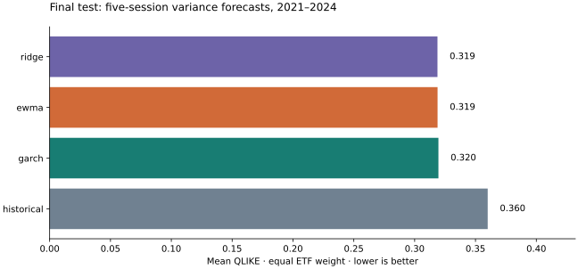
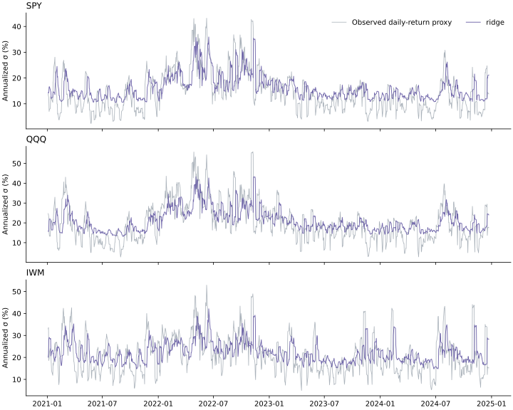

# VolatilityLab

## Does complexity improve volatility forecasts?

On this selected three-ETF case study, **RIDGE** has the lowest equal-weight test QLIKE (0.3188). This is a result for SPY, QQQ and IWM during 2021–2024, not a general ranking of model families.



## Design and estimand

Forecasts are made after close t. The target is Y_t = Σ(j=1…5) r²_(t+j), with r_t = log(P_t/P_(t−1)). This is a five-session, zero-mean daily-return variance proxy, not intraday realized volatility or the sample variance of five returns. All forecasts use decimal-return squared units and predict that same sum. No annualization is applied for scoring. The time-series display alone uses 100 × sqrt(252 × variance / 5). The conditional mean is assumed zero; this approximation is material for interpretation.

The universe is deliberately selected: SPY (large US equities), QQQ (Nasdaq-100 equities), and IWM (small US equities). These are established, liquid ETFs with long available histories. Liquidity is a selection rationale, not a measured screen in this project. The three funds overlap and are correlated. This is not a survivorship-free market sample.

Initial estimation: 2010–2017 (after 63-session feature warmup). Validation origins: 2018–2020. Untouched final test origins: 2021–2024, ending five sessions before the last available price. Training and validation origins whose labels end in the next partition are purged. Features at t use returns through t only. Supervised fitting at t includes only labels ending at or before t; therefore recent five-session targets are excluded until observable.

This is an adaptive, expanding walk-forward protocol: prior test outcomes may enter later supervised fits once fully observed, but test losses never select parameters. Ridge is refit every 21 evaluation origins on all observable labels. GARCH is refit on the latest 1,000 returns every 21 origins and filtered through each current close between refits. Historical and EWMA update daily. Validation and test each start with a new fit. Preprocessing is fit inside each ridge fit, never on future features.

All 14 candidate configurations were specified before test scoring: historical windows 21/63/126, EWMA decays .94/.97/.99, normal/Student-t GARCH(1,1), and ridge penalties .1/10/1000 crossed with full/volatility-only features. One configuration per model family is selected by mean validation QLIKE across the three ETFs. No post-test model selection is performed. The frozen selection records source, config and raw-data hashes; test execution rejects mismatches and refuses to overwrite an existing test run.

## Models

Historical: five times the rolling mean squared return. EWMA: five times the exponentially weighted second moment (adjust=False, initialized from the first return). GARCH: zero-mean GARCH(1,1) conditional variance, summed over five analytical horizons; fitted in percent returns then converted back by dividing by 10,000. Ridge: standardized 5/21/63-session mean squared returns, latest return, five-session cumulative return, and negative latest return; direct five-session variance regression in percent-squared units. The volatility-only ablation removes the three signed-return features. Ridge predictions below 1e−12 are floored, with every occurrence logged. GARCH failures never receive silent fallback forecasts.

## Final test results

| ETF | Model | Origins | QLIKE ↓ | MSE ↓ |
|---|---|---:|---:|---:|
| IWM | ewma | 1000 | 0.316089 | 7.085793e-07 |
| IWM | garch | 1000 | 0.313392 | 7.672854e-07 |
| IWM | historical | 1000 | 0.349453 | 7.584879e-07 |
| IWM | ridge | 1000 | 0.315072 | 7.524095e-07 |
| QQQ | ewma | 1000 | 0.284747 | 6.555774e-07 |
| QQQ | garch | 1000 | 0.285756 | 7.622278e-07 |
| QQQ | historical | 1000 | 0.311468 | 7.200038e-07 |
| QQQ | ridge | 1000 | 0.288921 | 7.060800e-07 |
| SPY | ewma | 1000 | 0.355684 | 2.372863e-07 |
| SPY | garch | 1000 | 0.359489 | 2.914233e-07 |
| SPY | historical | 1000 | 0.419220 | 2.596334e-07 |
| SPY | ridge | 1000 | 0.352280 | 2.688237e-07 |

Aggregate QLIKE: ridge: 0.3188; ewma: 0.3188; garch: 0.3195; historical: 0.3600.

QLIKE is y/f − log(y/f) − 1; lower is better, and a perfect proxy forecast scores zero. It penalizes underprediction sharply. MSE is in decimal-return fourth-power units. Both metrics are averaged over identical forecast origins; failed candidates are ineligible during validation and final-test failures stop the run.

## Comparison with the EWMA baseline

Complexity shows no clear improvement over EWMA in this case study. Ridge leads aggregate QLIKE by only 0.0000824, while EWMA has the lowest aggregate MSE. At block length 20, ridge minus EWMA QLIKE has a 95% interval of [−0.03185, 0.03147]; GARCH minus EWMA is [−0.02215, 0.02178]. Neither excludes zero at any of the three tested block lengths. These descriptive intervals do not prove equivalence or rule out useful gains elsewhere.

This secondary comparison was computed from the already frozen final-test forecasts to address both simple baselines. It introduced no new model configurations, refits, hyperparameter choices or test reruns. Code: scripts/compare_ewma.py. The primary source hash in frozen.json covers the package as evaluated; these reporting scripts are an additional transparent analysis of its outputs.

| Model | Mean Δ vs EWMA | Block 5 CI | Block 20 CI | Block 60 CI |
|---|---:|---|---|---|
| historical | 0.0412074 | [0.02256, 0.06362] | [0.01983, 0.06570] | [0.01916, 0.06886] |
| garch | 0.0007059 | [-0.01892, 0.01924] | [-0.02215, 0.02178] | [-0.02126, 0.01923] |
| ridge | -0.0000824 | [-0.02774, 0.02610] | [-0.03185, 0.03147] | [-0.03315, 0.03038] |

[Machine-readable comparisons](results/ewma_comparisons.json). The same synchronized block-bootstrap procedure and seed apply.

## Dependence-aware uncertainty

The paired statistic is each model’s QLIKE minus the selected historical baseline’s QLIKE, first averaged across ETFs for each date. A synchronized circular moving-block bootstrap resamples dates in blocks, preserving ETF correlation and local serial dependence from overlapping five-session targets. We use 2,000 replicates, seed 1729, and 95% percentile intervals at block lengths 5, 20 and 60. Negative deltas favor the model. These are descriptive, unadjusted intervals conditional on validation selection; they are not a multiple-testing-corrected discovery claim, and block length is a sensitivity assumption.

| Model | Mean Δ QLIKE | Block 5 CI | Block 20 CI | Block 60 CI |
|---|---:|---|---|---|
| historical | 0.0000 | [0.0000, 0.0000] | [0.0000, 0.0000] | [0.0000, 0.0000] |
| ewma | -0.0412 | [-0.0636, -0.0226] | [-0.0657, -0.0198] | [-0.0689, -0.0192] |
| garch | -0.0405 | [-0.0757, -0.0100] | [-0.0816, -0.0040] | [-0.0841, -0.0041] |
| ridge | -0.0413 | [-0.0833, -0.0044] | [-0.0893, 0.0039] | [-0.0948, 0.0058] |

## Sensitivity, ablations and failures

These are validation results. All tested configurations, fit parameters, fit warnings and failure events are in [validation.json](results/validation.json). Final-test fitting audit is in [test.json](results/test.json).

| Configuration | Validation QLIKE | Events |
|---|---:|---:|
| `{"model": "historical", "window": 21}` | 0.7021092438251326 | 0 |
| `{"model": "historical", "window": 63}` | 0.9727013641769098 | 0 |
| `{"model": "historical", "window": 126}` | 1.2319902489564145 | 0 |
| `{"decay": 0.94, "model": "ewma"}` | 0.654365220204011 | 0 |
| `{"decay": 0.97, "model": "ewma"}` | 0.7734295947799102 | 0 |
| `{"decay": 0.99, "model": "ewma"}` | 0.9946866929174113 | 0 |
| `{"distribution": "normal", "model": "garch"}` | 0.521730834625508 | 0 |
| `{"distribution": "t", "model": "garch"}` | 0.5142706760289029 | 0 |
| `{"alpha": 0.1, "features": "full", "model": "ridge"}` | 50713.010365206916 | 1 |
| `{"alpha": 0.1, "features": "vol_only", "model": "ridge"}` | 0.542685068915327 | 0 |
| `{"alpha": 10, "features": "full", "model": "ridge"}` | 50710.58511663715 | 1 |
| `{"alpha": 10, "features": "vol_only", "model": "ridge"}` | 0.5427945010533822 | 0 |
| `{"alpha": 1000, "features": "full", "model": "ridge"}` | 0.5580601355931554 | 0 |
| `{"alpha": 1000, "features": "vol_only", "model": "ridge"}` | 0.5528119744817718 | 0 |

Final-test logged failure/floor events: **0**. The full event records distinguish clipping from actual failed forecasts. All successful fits and any optimizer warnings are retained. No unreported candidate search was performed. Block-length sensitivity is reported above; feature ablation and penalty/decay/window sensitivity are reported in the validation table. GARCH window length and refit cadence are fixed design choices, not tuned dimensions.



## Data provenance and usage

Daily adjusted close comes from the publicly reachable Yahoo Finance chart endpoint. Yahoo defines adjusted close as accounting for splits and distributions ([provider explanation](https://in.help.yahoo.com/kb/adjusted-close-sln28256.html)). Retrieval uses adjclose explicitly, not an ambiguous Close column. These are retrospectively adjusted histories, not point-in-time vendor vintages; provider revisions and back adjustments may change future reruns. Constant historical rescaling cancels in adjacent log returns except for rounding. No claim of a fully point-in-time corporate-action dataset is made.

XNYS expected sessions provide the missing-observation audit. Prices are reindexed to those sessions; gaps are never forward-filled. Missing prices invalidate adjacent returns, feature windows and targets; incomplete rows are excluded before splitting. Nonpositive prices, duplicate dates and out-of-order observations cause errors. Weekends and exchange holidays are not missing observations.

| ETF | Retrieved UTC | First / last price | Observed | Missing XNYS sessions | Raw SHA-256 |
|---|---|---|---:|---:|---|
| SPY | 2026-11-02T19:19:11.236281+00:00 | 2010-01-04 / 2024-12-31 | 3774 | 0 | `b8bdbae9907b1f274b5fddba06b221fccdb65e4dbd5981f3fdaaeb1ef5ca97bc` |
| QQQ | 2026-11-02T19:21:40.366690+00:00 | 2010-01-04 / 2024-12-31 | 3774 | 0 | `2ad6e03af5fa1333765599471489eaf5ed1c97de5dd6228717af0c71c19229a4` |
| IWM | 2026-11-02T19:21:40.366957+00:00 | 2010-01-04 / 2024-12-31 | 3774 | 0 | `31dd97c9e6b8708ca7e2d3d9ff200dbea6096f64b23ed20bc4a8b9b6e0cb04d6` |

Source request URLs and any missing dates appear in test.json. Public access does not imply permission to redistribute market data. Yahoo and upstream providers retain their rights; consult [Yahoo terms](https://legal.yahoo.com/us/en/yahoo/terms/otos/index.html) and applicable finance/data terms before use. No raw price histories are distributed in this repository. MIT covers the code, not market data. The published research includes derived forecasts and loss values for transparency, not a substitute price feed.

## Reproduction

Run from the repository root with Python 3.14 (the recorded environment):

```bash
python3 -m venv .venv
source .venv/bin/activate
pip install -r requirements-lock.txt
pip install --no-deps -e .
pytest -q
volatilitylab validate --out docs/reproduction
volatilitylab test --out docs/reproduction
python scripts/build_report.py --out docs/reproduction
python -m http.server 8000 --directory docs
```

The published directory docs/results is immutable evidence of this run; use a fresh output directory for reproduction. Downloaded inputs cache under ignored data/raw; keep the cache to reproduce exact prices. The registry lock pins the observed environment. The data provider may rate-limit or revise histories; failed downloads stop execution. Exact original data hashes can be checked, but byte-exact reruns require the original local cache because redistribution rights are not assumed. No network is used by the offline tests. All fixtures in tests/fixtures are explicitly synthetic.

## Limitations

A single selected universe, one validation window and one test window cannot establish universal superiority. All ETFs share equity risk; there is no independent asset-class replication. Five daily returns form a noisy variance proxy and miss intraday price variation and microstructure effects. Retrospective adjustments, a small configuration grid, fixed refit frequency, bootstrap assumptions, and regime changes limit interpretation. Training outcomes enter the walk-forward model only after they become observable; this does not make vendor vintages point-in-time. Repeated future research on this test period would require a new holdout. Forecast accuracy is not tradable profitability: no strategy, execution costs, portfolio returns, recommendations or brokerage integration are evaluated.

## References and audit files

[GARCH analytical forecasting documentation](https://arch.readthedocs.io/en/stable/univariate/forecasting.html) · [frozen selection](results/frozen.json) · [all validation configurations](results/validation.json) · [test provenance and fitting audit](results/test.json) · [per-origin forecasts and losses](results/forecasts.csv).

Implementation version 1.0.0. Python 3.14.7. Packages: {"arch": "8.0.0", "exchange-calendars": "4.13.2", "matplotlib": "3.11.2", "numpy": "2.5.4", "pandas": "3.1.0", "scikit-learn": "1.9.1", "scipy": "1.18.1"}. Source SHA-256: `1ef6cce84b99f1218f2501682bfc339738aa76ed33d29a19b84a66001c547891`. Config SHA-256: `e8f75dc0143d26fda28f1cec4fe8bf48b8e5229b33c0425a1227b9cf19aeb4aa`. Selection frozen: 2026-11-02T19:22:58.481402+00:00. Test generated: 2026-11-02T19:23:20.181402+00:00.
